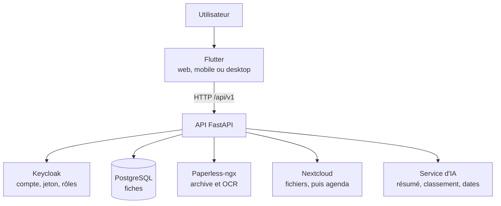
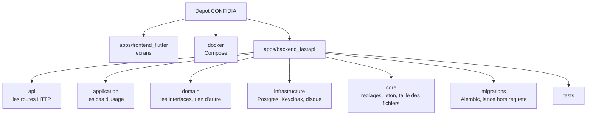
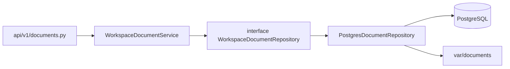
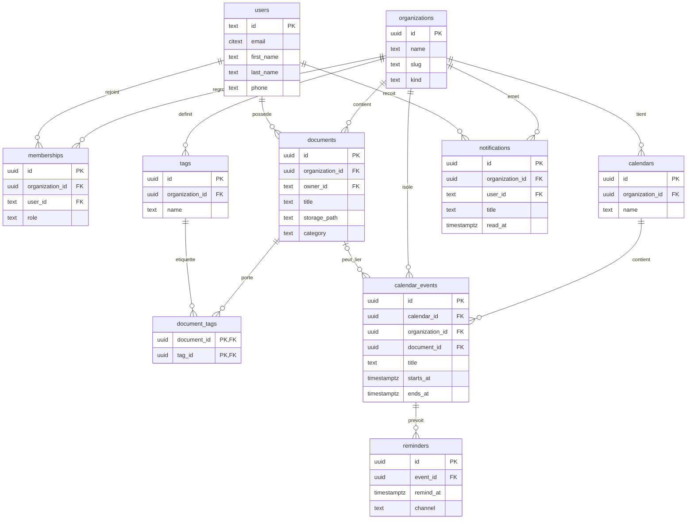

# CONFIDIA, présentation Holberton

Support pour l'oral. Les schémas s'affichent dans la prévisualisation Markdown (GitHub, Cursor, VS Code).

## Le pitch

La paperasse du quotidien est éparpillée. La facture est dans les mails, le contrat sur un drive, la date dans la tête. CONFIDIA est l'endroit où je dépose tout ça, et où je le retrouve le jour où j'en ai besoin.

J'ouvre l'application, je me connecte, je vois ma semaine. J'importe un document, je lui donne un titre, je le rouvre, je le télécharge. Il est encore là si je reviens plus tard. Le calendrier et le profil sont là aussi. La messagerie, les paiements et l'organigramme se voient à l'écran, mais ce sont des aperçus : ils montrent la suite, ils ne rangent rien pour de vrai.

## Le projet

L'objectif de ce dépôt n'est pas toute la vision produit. C'est un MVP Holberton que quelqu'un d'autre peut lancer : un vrai compte, une vraie base, un fichier qui reste là après un rafraîchissement.

Ce que je montre :

- la connexion, avec Keycloak
- l'accueil, avec la semaine en cours
- l'import d'un PDF, son titre, sa fiche, son téléchargement
- la déconnexion

Le calendrier interne et le profil (téléphone enregistré en base) sont là si j'ai le temps. La messagerie, les paiements et l'organigramme portent un badge Démo. Je ne les ouvre pas : ils ne parlent pas à la base.

## Démo

Avant l'oral, depuis la racine du dépôt :

```bash
./scripts/start.sh
```

J'attends que le script affiche que la stack est prête. Keycloak est sur le port 8080, l'API sur le port 8000. Je ne lance pas un second serveur à côté.

Puis, dans un autre terminal :

```bash
cd apps/frontend_flutter
flutter run -d chrome --web-port=8082
```

Compte de démo : `user` / `user`. Je prépare un petit PDF avant l'oral (une facture, n'importe laquelle). Il n'y en a pas dans le dépôt.

| Moment | Ce que je fais | Ce qu'on doit voir |
|--------|----------------|--------------------|
| Connexion | **Se connecter**. Pas **Mode démo**. | L'accueil, avec la bande de la semaine. |
| Accueil | Je reste sur l'accueil. | Une session vide de faux historique. |
| Import | **Documents**, **Importer** (pas Scanner sur un ordinateur), je choisis le PDF, je pose un titre, **Importer**. | La ligne apparaît dans la liste. |
| Fiche | J'ouvre la ligne, **Télécharger**. | Le titre saisi, et le même fichier. |
| Persistance | Je rafraîchis la liste. | Le document est toujours là. |
| Sortie | Puce profil ou **Paramètres**, **Se déconnecter**, puis **Déconnexion**. | Retour à l'écran de connexion. |

Phrase utile si on me demande où est le fichier : les métadonnées sont dans PostgreSQL, les octets sur le disque de l'API (`var/documents`). Pas dans Paperless.

Si le temps reste, j'ajoute un événement dans **Calendrier**, puis je jette un œil à l'accueil. Aucune synchro Google, Outlook ou Apple.

Si la connexion tourne puis échoue, Keycloak n'est pas encore prêt. J'attends, je ne relance pas une autre API.

## Architecture

Voici l'architecture visée. L'application ne connaît qu'une adresse, l'API. Le compte, les fiches, les fichiers et l'IA sont derrière. On remplace un service sans réécrire les écrans.



Flutter n'appelle personne d'autre. FastAPI parle à Keycloak pour le compte, à PostgreSQL pour les fiches, à Paperless pour le document et l'OCR, à Nextcloud pour l'espace de fichiers (et plus tard le calendrier CalDAV), et à un service d'IA branché sur la même interface : résumé, classement, dates, montants.

Le jour de l'oral, deux branchements sont plus simples. Le PDF va sur le disque de l'API (`var/documents`), pas dans Paperless. L'IA renvoie un texte fixe. Nextcloud démarre avec Docker, l'écran Documents ne s'en sert pas. Le dessin, lui, reste celui de la cible.

## Les dossiers

Le dépôt a trois grands morceaux. `apps/frontend_flutter` est l'application qu'on voit. `docker` lance les services avec Compose. `apps/backend_fastapi` est l'API. C'est ce dernier qu'on m'a demandé de détailler.



Chaque dossier a un seul métier.

- `api/` reçoit la requête HTTP. `api/v1/documents.py` est la route d'upload. Elle vérifie le jeton et la taille du fichier. Elle ne parle pas à PostgreSQL elle-même.
- `application/` fait le travail. `WorkspaceDocumentService` décide quoi enregistrer. Les `dto/` sont la forme des données qui entrent et qui sortent.
- `domain/` ne contient pas de base de données. Ce sont des interfaces, des contrats. `WorkspaceDocumentRepository` dit « on doit pouvoir créer, lister, lire et supprimer un document », sans dire comment.
- `infrastructure/` fait le comment. `PostgresDocumentRepository` écrit la fiche dans PostgreSQL et les octets dans `var/documents`. Keycloak, Paperless et Nextcloud sont dans ce même dossier, mais l'écran Documents n'utilise que Postgres et le disque.
- `core/` est transversal : les réglages, la lecture du jeton, la limite de taille d'un fichier.
- `migrations/` ne tourne pas pendant une requête. Alembic applique le schéma, une fois, au démarrage. Le fichier `001_mvp_schema.py` crée les dix tables. C'est l'historique de la structure, pas la logique de l'import.
- `tests/` vérifie ces pièces, avec parfois de fausses bases pour ne pas dépendre de Docker.

Pour un import, le chemin est celui-ci.



L'interface est au milieu pour qu'on puisse changer le stockage plus tard sans réécrire la route. Aujourd'hui, l'implémentation derrière est Postgres plus le disque.

## Base de données

PostgreSQL. Dix tables pour le MVP. Les mots de passe n'y sont pas : ils restent dans Keycloak. `users.id` est le `sub` du jeton, en texte.

Un utilisateur est un compte. Sa ligne ne porte pas d'organisation. Il en rejoint une par `memberships`, ou aucune : zéro, une ou plusieurs. Une organisation est un espace de travail, pas un foyer. Le champ `kind` dit lequel : `personal`, `family`, `club` ou `org`.

Le mot foyer vient seulement de la démo. Au premier login, s'il n'y a encore aucune organisation, le code en crée une nommée Famille (`kind = family`), pour avoir où poser un document. Le schéma ne l'oblige pas. Un compte sans ligne dans `memberships` est valide. En revanche, un document, un calendrier ou une notification a toujours une organisation : ces fiches ne vivent pas sur le compte tout seul.

Le rôle Keycloak (`USER`, `MANAGER`, `ADMIN`) est dans le jeton. Le rôle dans une organisation (`owner`, `admin`, `member`) est dans `memberships`. Ce n'est pas le même rôle.



Chaque table :

- `organizations`, un espace de travail
- `users`, le compte, sans le mot de passe
- `memberships`, le rattachement d'un compte à un espace, s'il y en a un
- `documents`, la fiche du fichier
- `tags`, une étiquette de l'espace
- `document_tags`, le lien entre un document et une étiquette
- `calendars`, un agenda de l'espace
- `calendar_events`, un créneau dans un agenda
- `reminders`, l'alarme d'un événement : quand prévenir, et par quel canal (`in_app`, `push` ou `email`). Ce n'est pas le créneau, ni le message déjà reçu. La table est prête, l'API ne la remplit pas encore
- `notifications`, le message adressé à un compte, lu ou non

Lecture rapide des cardinalités :

- un compte peut n'appartenir à aucune organisation, ou à plusieurs, une seule fois dans chacune
- une organisation regroupe zéro ou plusieurs comptes
- un document a exactement un propriétaire et exactement une organisation, et zéro ou plusieurs étiquettes
- un calendrier appartient à une organisation et contient zéro ou plusieurs événements
- un événement peut pointer vers un document, ou vers aucun
- un événement a zéro ou plusieurs rappels
- une notification vise un utilisateur, dans une organisation

La liste des documents est filtrée sur l'organisation du compte connecté. Deux inscriptions séparées créent deux espaces. Deux membres du même espace voient les mêmes documents.

`organization_id` est aussi sur l'événement. Ça permet de lister la semaine de cet espace sans passer par le calendrier. `document_id` est facultatif : d'où le `o` du côté document.

Pas dans cette base : mails, paiements, signatures, analyses d'IA. Ces écrans existent dans l'interface, en démo, sans tables.

Les suppressions sont logiques (`deleted_at`) pour les organisations, les comptes, les membres, les documents, les calendriers, les événements et les notifications. Les étiquettes n'ont pas ce champ. Le lien document / étiquette et les rappels ne partent en cascade que si on fait un vrai `DELETE`. La suppression d'un document ne le fait pas.

### Pourquoi un soft delete sur les documents

Supprimer un document ne retire pas la ligne. `delete_for_org` remplit `deleted_at`. Les listes, la fiche et le téléchargement ignorent ces lignes. Il n'y a pas de route pour annuler.

Je ne fais pas un `DELETE` pour deux raisons concrètes.

Un événement peut pointer vers le document. Cette clé étrangère n'a pas de `ON DELETE`. Un vrai `DELETE` serait refusé tant que le lien existe. Avec `deleted_at`, le document sort de l'écran, et l'événement peut rester.

Le schéma prévoit une purge plus tard, pour l'effacement au sens du RGPD. Cette purge n'existe pas. La ligne reste. Le fichier sur le disque aussi : `delete_for_org` ne touche pas à `var/documents`.

## RGPD

Le projet n'est pas conforme au RGPD. Il traite des données personnelles, et plusieurs droits de la personne ne sont pas en place.

Ce que l'application détient vraiment :

- le compte : e-mail, nom, téléphone. Le mot de passe est chez Keycloak, pas dans PostgreSQL
- les documents : le titre en base, le fichier sur le disque de l'API
- l'agenda : titre, lieu, horaires
- les jetons de session, gardés sur l'appareil, pas dans notre base

Ce qui est déjà là, modestement. On ne crée pas de tables au-delà du MVP. Le mot de passe ne passe pas par notre base. Un document supprimé disparaît de l'écran.

Ce qui manque, et qui concerne directement ce projet :

- le droit d'accès et la portabilité : on peut lire son profil, il n'y a pas d'export de toutes ses données
- le droit à l'effacement : pas de suppression de compte. Le soft delete cache la fiche, il ne l'efface pas, et le fichier reste sur le disque
- la durée de conservation : aucune purge, aucune limite
- l'information de la personne : rien n'est expliqué au moment de créer le compte, pas de case de consentement
- le reste du cadre : pas de registre des traitements, pas de contact, pas de procédure si des données fuient

L'export et l'effacement sont dans la suite. Les écrire dans la présentation ne les rend pas faits.

## Technos, et ce que le développement m'a appris

| Brique | Rôle |
|--------|------|
| Flutter, Riverpod, GoRouter, Dio | L'interface, l'état, les routes, les appels HTTP |
| FastAPI, Pydantic, Python 3.12 | L'API et la validation |
| PostgreSQL 16, SQLAlchemy, Alembic | Les données et les migrations |
| Keycloak | Les mots de passe, les jetons, les rôles |
| Docker Compose | Tout lancer avec `./scripts/start.sh` |
| GitHub Actions | pytest, tests Flutter, vérification du Compose |

Paperless-ngx, Nextcloud et l'IA sont dans l'architecture visée. Pour la démo, le fichier est sur le disque, et l'IA reste un texte fixe.

**Ce qui a bien fonctionné.** Séparer le client et l'API. Une fois que Flutter n'a plus qu'une URL, Keycloak peut être lent, PostgreSQL peut redémarrer, l'écran ne change pas. Le script de démarrage attend vraiment que Keycloak et `/health` répondent, au lieu de me laisser deviner. Le titre du document se saisit à l'import, pas seulement après coup.

**Les difficultés.** 

Sur Mac, compiler l'application native demande Xcode complet. Les outils en ligne de commande ne suffisent pas. La démo Holberton reste donc dans Chrome.

**Ce que j'améliorerais.** Remplacer les réponses fixes de l'IA par un vrai modèle. Synchroniser un calendrier externe. Prévoir l'export et la suppression des données, au sens du RGPD. Le profil, lui, est déjà enregistré dans PostgreSQL. Je ne le compte plus dans la suite.

## Et après

1. Un fournisseur d'IA réel derrière la même interface que le mock, sans réécrire les écrans.
2. Une synchro de calendrier (CalDAV), en plus de l'agenda interne.
3. Des notifications push. Le schéma a déjà le canal, l'envoi n'est pas branché.
4. L'export et l'effacement des données d'une organisation.
5. Plus tard, une publication mobile.

## Conclusion

On peut cloner le dépôt, lancer la stack, se connecter, importer un PDF et le retrouver. C'est ça que je viens montrer. Le reste de la vision produit est visible dans l'interface, assumé comme démo, et absent du schéma de base. Je préfère un parcours court et vrai qu'une application qui a l'air finie et qui ne l'est pas.
